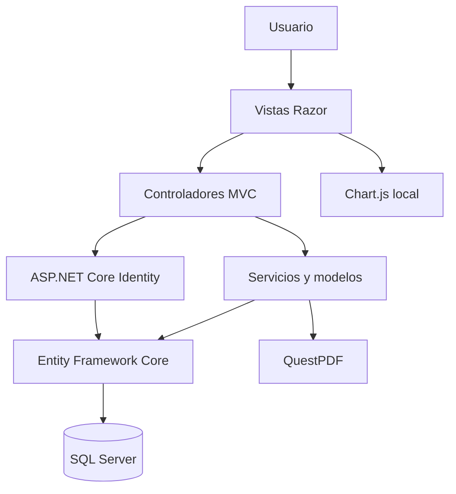

# Arquitectura

CloudBooks es un monolito ASP.NET Core MVC. Los controladores reciben y autorizan peticiones, los servicios concentran las reglas y EF Core persiste entidades en SQL Server. Razor presenta modelos sin consultar directamente la base.

Identity administra cuentas y roles. Las solicitudes de cuenta y sus cambios de rol se resuelven en una transacción. Las solicitudes comerciales se asignan por carga; cotizaciones reutiliza el motor de descuentos y el PDF se genera bajo demanda después de verificar acceso.

Los roles `ClienteMinorista` y `ClienteInstitucional` son alternativas comerciales: la aprobación retira el primero y asigna el segundo. La gestión administrativa protege las cuentas administradoras y no permite modificar el rol propio. La tasa de impuesto, el umbral de stock y la vigencia se almacenan en configuración; cada pedido o cotización conserva sus propios importes y tasa.

La aprobación de pedidos usa una transacción y actualizaciones condicionadas por estado y existencias. El dashboard considera ventas únicamente a pedidos aprobados y enviados.
