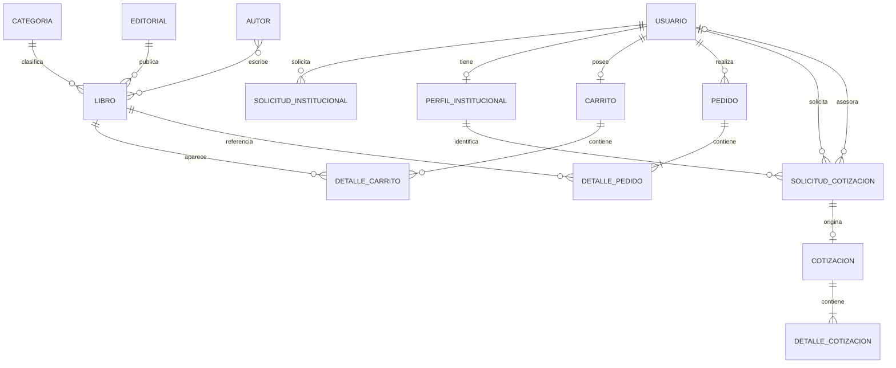

# Modelo de datos

Identity relaciona usuarios y roles mediante sus propias tablas. Un índice filtrado impide más de una solicitud institucional pendiente por usuario; el perfil y el carrito son únicos por usuario. Los libros se desactivan lógicamente; los detalles de pedidos conservan título y precio históricos.

La solicitud comercial vincula cliente, perfil y asesor opcional. La interfaz emite una cotización con un concepto. La emisión y respuesta actualizan estados de solicitud y cotización en transacción. Los importes son `decimal`; la tasa aplicada y el vencimiento se conservan en cada operación. La fila `ConfiguracionSistema` contiene los valores vigentes para nuevas operaciones.
